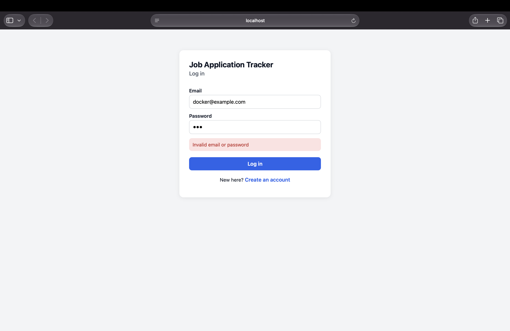
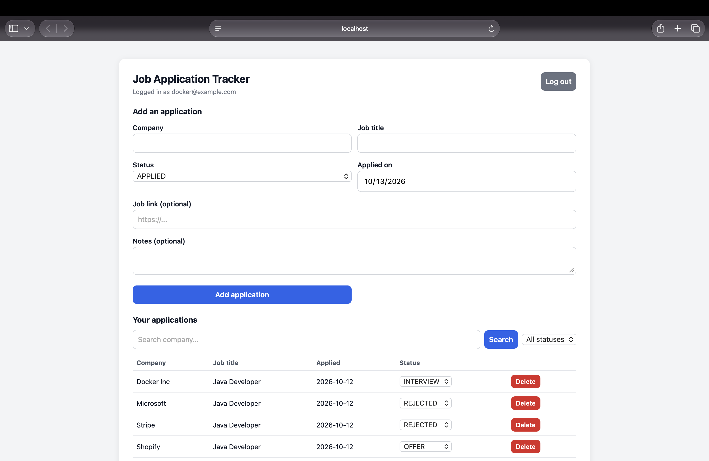
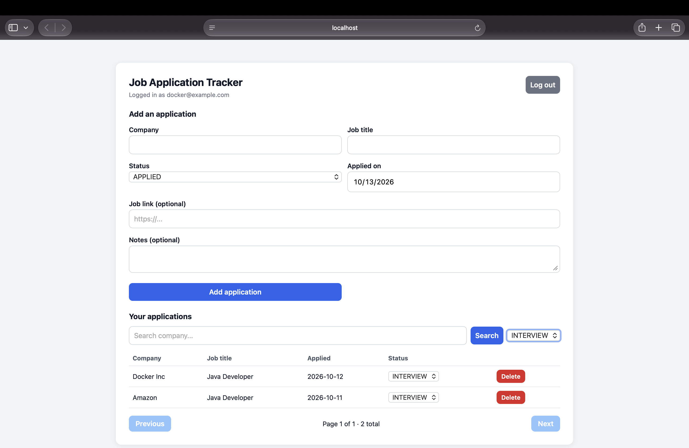
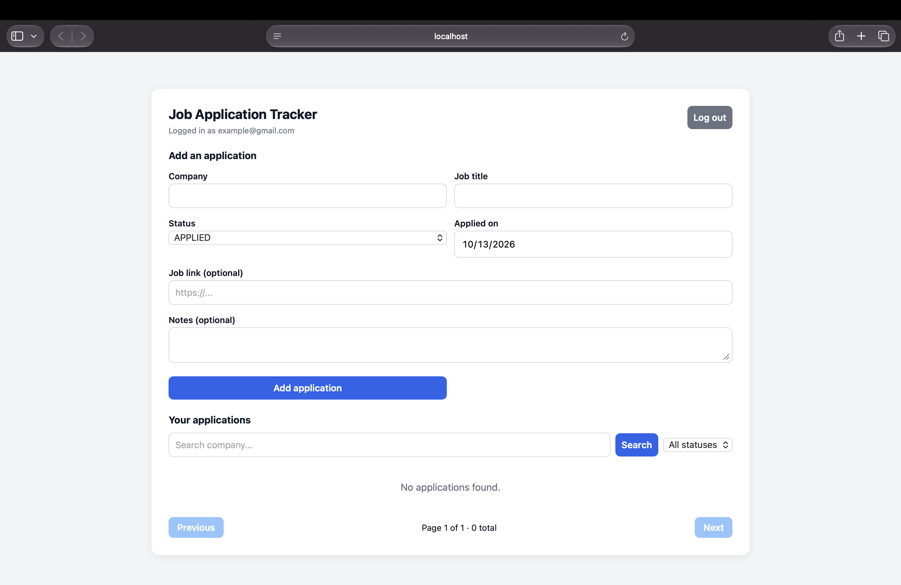
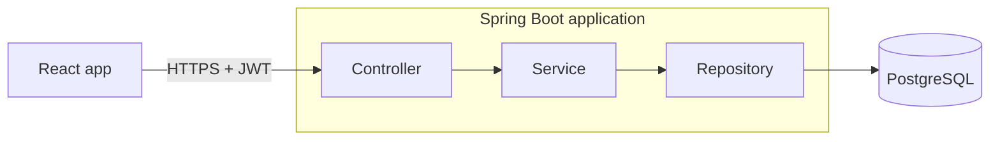
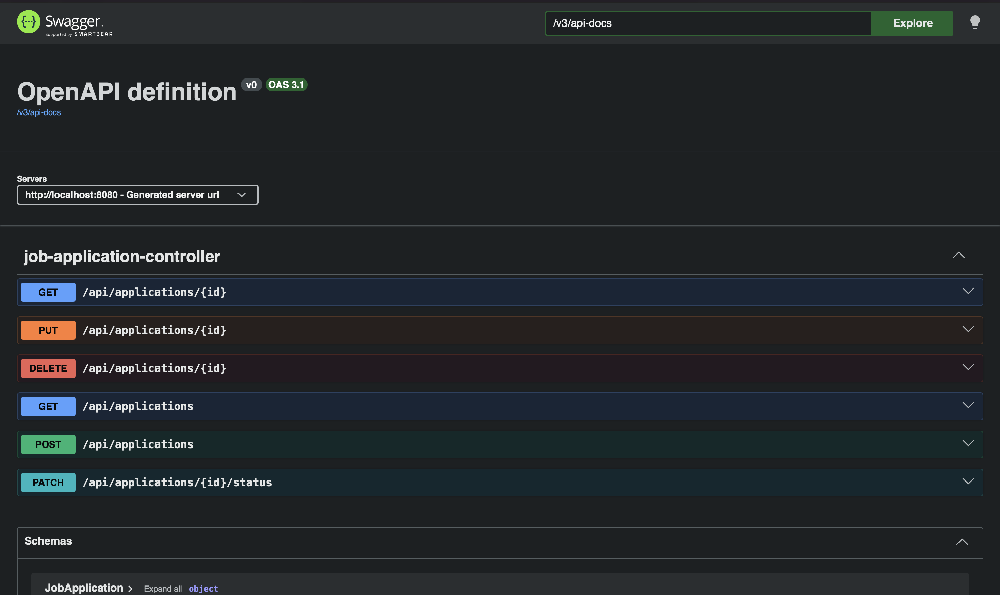
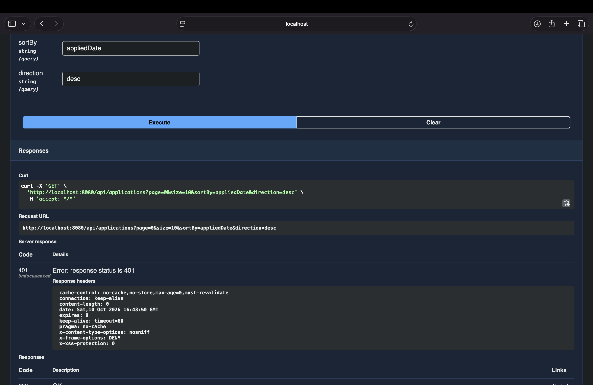
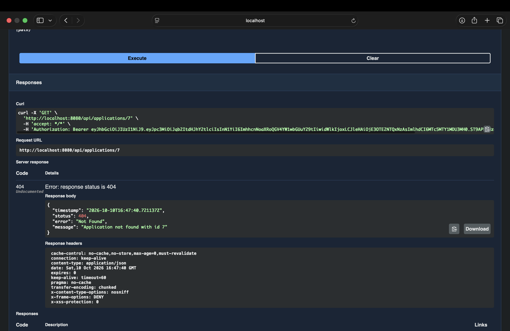
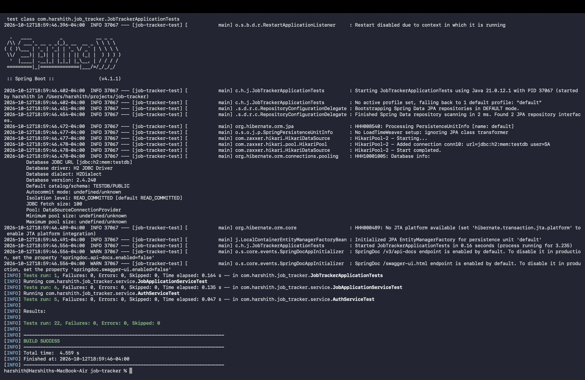
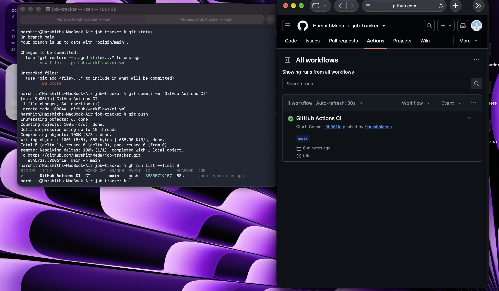

# Job Application Tracker


A full-stack web app for tracking job applications. Users register, log in, and manage their own applications (company, title, status, date, link, notes) with search, filtering, sorting and pagination. Built with **Java 21, Spring Boot, PostgreSQL, JWT authentication and React**, tested with JUnit, Mockito and MockMvc, containerized with Docker and checked by GitHub Actions on every push.

**Live demo:** https://job-tracker-f4gn.onrender.com

> The demo runs on free hosting and **sleeps after 15 minutes of inactivity**. The first visit can take about a minute to wake up.
>
> Demo login: `demo.viewer@example.com` / `DemoPass2026` (a shared test account with fake data only; please don't store real information in it).

## Screenshots

| Login | Home |
|---|---|
|  |  |

| Search and filter | Another user sees only their own data |
|---|---|
|  |  |


## Features

- Register and log in; passwords are stored as BCrypt hashes
- Stateless JWT authentication (tokens expire after 60 minutes)
- Create, view, update, delete applications, and change status (Applied, Interview, Offer, Rejected)
- Search by company, filter by status, sort, and paginate (page size capped at 50)
- **Per-user data isolation:** every record has an owner taken from the verified token, and other users' records return 404
- Validation with clear error messages (400, 401, 404, 409) from one global exception handler
- Interactive API documentation with Swagger UI
- 22 automated tests, plus CI on every push

## Tech stack

| Area | Technology |
|---|---|
| Language | Java 21 |
| Backend | Spring Boot 4.1, Spring Web MVC, Spring Data JPA (Hibernate), Bean Validation |
| Security | Spring Security, JWT (HS256) via the OAuth2 resource server, BCrypt |
| Database | PostgreSQL 17 |
| Frontend | React (Vite), ESLint |
| API docs | springdoc OpenAPI / Swagger UI |
| Testing | JUnit 5, Mockito, MockMvc, H2 (in-memory, tests only) |
| DevOps | Docker (multi-stage build), Docker Compose, GitHub Actions |
| Hosting | Render (app) and Neon (PostgreSQL) |

## Architecture



- **Controller:** handles HTTP requests, validates input, reads the user id from the token
- **Service:** business rules (ownership checks, filtering, pagination limits)
- **Repository:** database access with Spring Data JPA
- **DTOs** keep request and response shapes separate from the database entities
- The React build is copied into the Spring Boot jar, so one Docker image serves both the UI and the API

## API

| Method | Path | Auth | Description |
|---|---|---|---|
| POST | `/api/auth/register` | No | Create an account (201, 400, 409) |
| POST | `/api/auth/login` | No | Returns a JWT (200, or 401 for wrong credentials) |
| GET | `/api/me` | Yes | The logged-in user |
| GET | `/api/applications` | Yes | List with `status`, `company`, `page`, `size`, `sortBy`, `direction` |
| POST | `/api/applications` | Yes | Create an application |
| GET | `/api/applications/{id}` | Yes | Get one (404 if missing or owned by someone else) |
| PUT | `/api/applications/{id}` | Yes | Replace the details |
| PATCH | `/api/applications/{id}/status` | Yes | Change only the status |
| DELETE | `/api/applications/{id}` | Yes | Delete (204) |

Interactive docs: `/swagger-ui/index.html`



## Security design

- Passwords are hashed with BCrypt (salted, deliberately slow) and never stored in plain text
- JWTs are signed with a secret that is generated per environment and kept out of the repository (`local.properties` and `.env` are git-ignored)
- The same error message is returned for a wrong email and a wrong password, so attackers can't learn which emails exist
- The owner of a record always comes from the verified token, never from the request body
- Requests for another user's record return 404 instead of 403, so ids can't be discovered
- Sorting is limited to a whitelist of fields and page size is capped
- The container runs as a non-root user

| Not logged in (401) | Other user's record (404) |
|---|---|
|  |  |

## Testing and CI

- **Unit tests** (JUnit 5 and Mockito) cover the services: ownership rules, password hashing, duplicate emails, wrong passwords
- **Integration tests** (`@SpringBootTest` and MockMvc) cover the secured API end to end: missing and forged tokens, per-user isolation, validation, filtering and pagination
- Tests use an in-memory H2 database and a dummy secret, so they need no PostgreSQL and no local secrets
- **GitHub Actions** runs three jobs on every push: backend tests, Docker image build, and frontend lint and build

```bash
./mvnw test
```





## Run it locally

You need Docker Desktop. Node 22 or newer is only needed for frontend development.

### Option A: everything in Docker (app and database)

```bash
cp .env.example .env
```

Edit `.env` and set two values. You can generate them with:

```bash
openssl rand -hex 16   # DB_PASSWORD
openssl rand -hex 32   # JWT_SECRET
```

Then:

```bash
docker compose up --build
```

Open http://localhost:8080 for the app, or http://localhost:8080/swagger-ui/index.html for the API docs.

### Option B: frontend development with hot reload

Start the backend with Option A, then in another terminal:

```bash
cd frontend
npm install
npm run dev
```

Open http://localhost:5173. The dev server proxies `/api` requests to port 8080.

## Design decisions and known limitations

- **JWT in `localStorage`:** simple, but readable by any script running on the page. A more hardened design would use an `HttpOnly` cookie.
- **No refresh tokens or revocation:** a token stays valid until it expires (60 minutes).
- **`spring.jpa.hibernate.ddl-auto=update`** creates the schema automatically for this project. In production I would use versioned migrations with Flyway.
- **No rate limiting** on login yet.
- **Swagger UI is public** on the demo for easy review.
- **The frontend has no automated tests** yet; it is covered by lint and build checks in CI.
- **Free hosting** sleeps when idle, so the first request can be slow.

## Project structure

```
src/main/java/com/harshith/job_tracker/
  config/        OpenAPI configuration
  controller/    REST controllers
  dto/           request and response objects
  exception/     custom exceptions and the global handler
  model/         JPA entities and enums
  repository/    Spring Data repositories
  security/      Spring Security and JWT configuration
  service/       business logic
src/test/        unit and integration tests
frontend/        React app (Vite)
Dockerfile       multi-stage build (React, then jar, then runtime image)
compose.yaml     app and PostgreSQL for local use
.github/workflows/ci.yml   GitHub Actions pipeline
```

## Author

Harshith Meda — [GitHub](https://github.com/HarshithMeda)
